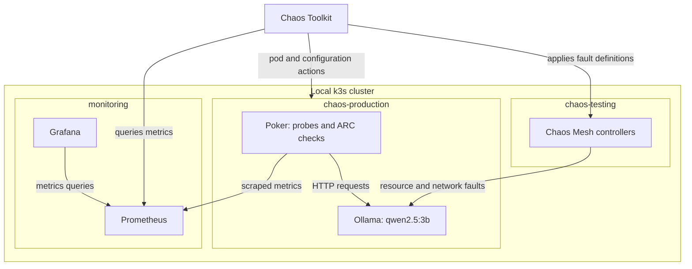
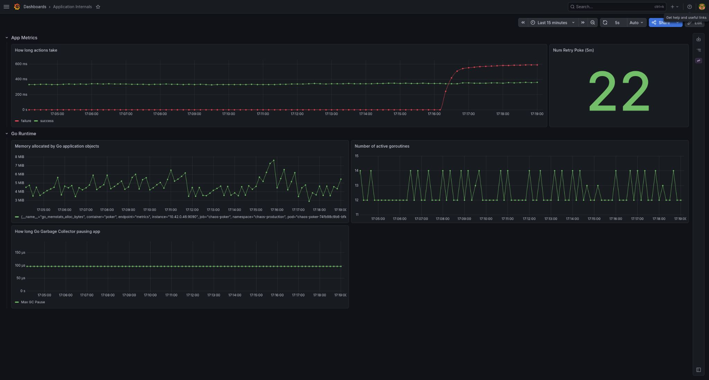
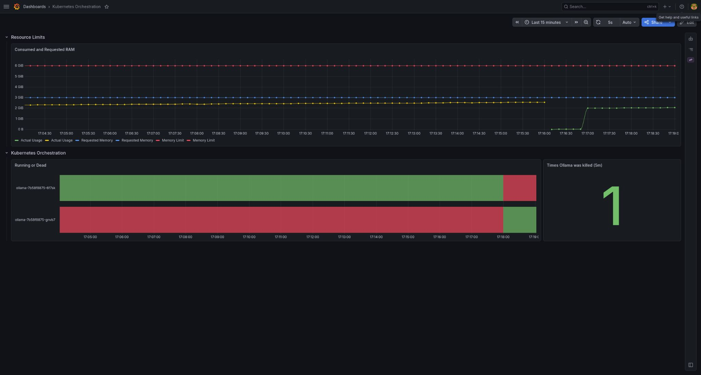
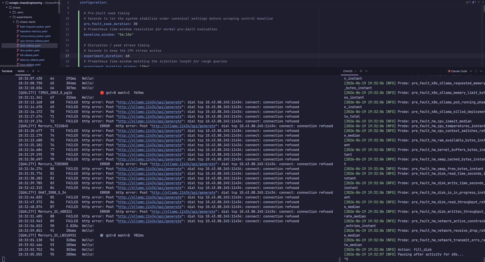

# Chaos Engineering for an Ollama Service

An academic project that injects controlled failures into a Kubernetes environment and observes how an Ollama-based service degrades and recovers.

Developed individually by Cristiano Cascarrinho at the University of Évora for the 2025/2026 Computer Science Engineering internship project, supervised by Rui Oliveira.

**Go · Docker · k3s · Chaos Toolkit · Chaos Mesh · Prometheus · Grafana · Ollama**

## What I built

- **Poker**, a Go application that continuously probes Ollama, retries failed requests with exponential backoff, and exposes Prometheus metrics.
- A local **k3s test environment** with separate namespaces for the application, monitoring and Chaos Mesh.
- **Five provisioned Grafana dashboards** covering application internals, containers, hardware, Kubernetes and ARC-Challenge evaluation.
- **YAML experiments** orchestrated by Chaos Toolkit, using Chaos Mesh for resource and network faults and Kubernetes actions for other scenarios.
- Periodic **ARC-Challenge checks** to compare answer correctness, response time and timeouts during experiments, using a fixed dataset shuffle for repeatable question ordering.

The main finding was that the tested faults affected **latency, availability and recovery** more clearly than answer correctness. The project did not establish a consistent reduction in model accuracy under resource pressure.

## Architecture



Chaos Mesh controllers run in `chaos-testing`; fault resources select workloads in `chaos-production`. Prometheus also collects cluster, container and host metrics used by the dashboards.

## Experiments and findings

The following observations come from the internship report, particularly Sections 5.2.2 and 5.6. They describe the recorded local experiments, rather than performance guarantees for other hardware or model versions.

| Scenario | Observed behaviour | What it showed |
| --- | --- | --- |
| CPU stress on Ollama | Response latency and CPU temperature increased during the experiment. | Resource contention was visible in both application and host metrics. |
| Network delay | A configured delay of 150 ms with 50% correlation increased response latency without the same CPU and temperature effects. | Similar application symptoms can have different infrastructure causes. |
| Pod deletion and storage-pressure eviction | Poker temporarily lost access to Ollama; Kubernetes created a replacement pod and requests resumed. | Automatic recovery restored service after a period of unavailability. |
| Nonexistent model | Poker remained active but could not obtain valid responses from its dependency. | An application process being alive does not imply successful dependency calls. |
| ARC-Challenge checks under faults | Answer accuracy did not show a consistent degradation; latency and timeouts were more informative. | The original accuracy-degradation hypothesis was not supported by these runs. |

### Application behaviour during a fault



*Application Internals dashboard from slide 8 of the project presentation. Failed-probe latency and retry activity become visible alongside the Go runtime metrics.*

### Kubernetes recovery



*Kubernetes Orchestration dashboard from slide 9. The pod-state timelines show the transition between the old Ollama pod and its replacement.*

<details>
<summary>View the failure and recovery logs</summary>



*Terminal capture from slide 7. Poker reports connection-refused errors during an interruption and resumes successful requests when the dependency becomes reachable.*

</details>

The screenshots are historical captures from the presentation. Their run settings can differ from the current YAML defaults. They illustrate behaviour; they do not replace experiment journals or a repeatable benchmark dataset.

## Run locally

Use a dedicated local test cluster: these experiments intentionally disrupt workloads. The deployment workflow targets **k3s with containerd** and imports locally built images using `sudo k3s ctr`.

### Prerequisites

- Linux with a running k3s cluster and a working `kubectl` context.
- Docker, Helm, Git and Make; permission to build Docker images and run `sudo k3s ctr`.
- `uv` for the Python-based Chaos Toolkit environment.
- Go 1.23 or newer if building the application outside Docker; the Docker build supplies its own Go toolchain.

The current Ollama manifest requests **2 CPU cores and 3 GiB RAM**, with limits of **8 cores and 6 GiB RAM**. The host also needs capacity for Poker, monitoring and fault injection, plus disk space for model downloads and images. Those requests are not a complete minimum hardware specification.

### Deploy the environment

```bash
git clone https://github.com/NotCristiano/estagio-chaosEngineering.git
cd estagio-chaosEngineering
make deploy-k8s
kubectl -n chaos-production get pods
kubectl -n monitoring get pods
kubectl -n chaos-testing get pods
```

`make deploy-k8s` installs the monitoring and Chaos Mesh Helm releases, builds and imports the Poker and Ollama images, and applies the application manifests and dashboard definitions. The Ollama image build downloads `qwen2.5:3b`, so the first build can take some time. Wait until the workloads are ready before starting an experiment.

| Local endpoint | Purpose |
| --- | --- |
| `http://localhost:30300` | Grafana dashboards. |
| `http://localhost:30900` | Prometheus; also used by the experiment YAML. |
| `http://localhost:30233` | Chaos Mesh dashboard. |
| `http://localhost:30434` | Ollama API. |

These addresses assume the k3s node is reachable through localhost. For a remote node, use its address and adjust the experiments' `prometheus_base_url`. Keep these lab endpoints on the test machine or a restricted network. Configure dashboard access in your local Helm values rather than including credentials in documentation.

### Establish a baseline and run an experiment

```bash
make -C chaos setup
make -C chaos run-baseline
make -C chaos report-baseline
make -C chaos run-stress-cpu
make -C chaos report-comparison
```

The current CPU-stress YAML configures a 5-minute pre-fault period, 30 minutes of stress and a 5-minute recovery period. Review a scenario's configuration before running it; experiment durations are not necessarily short.

The generated baseline and comparison HTML reports are written under `chaos/`, alongside the JSON journals. Correlate them with the Grafana timelines: the report explains that interpreting the impact still required manual analysis of the collected metrics.

| Make target under `chaos/` | Scenario |
| --- | --- |
| `run-stress-cpu` | CPU stress on Ollama |
| `run-latency` | Network delay |
| `run-loss` | Packet loss |
| `run-dns` | DNS failure |
| `run-oom` | Memory pressure |
| `run-disk` | Storage pressure |
| `run-scale` | Poker replica changes |
| `run-concurrency` | Concurrent Poker workers |
| `run-bad-request` | Invalid model configuration |
| `kill-ollama` | Ollama pod deletion |

### Logs and lifecycle

```bash
make logs
make logs-ollama
make pause
make resume
```

`make pause` and `make resume` scale the application and selected monitoring workloads. They are not a full cluster shutdown. For removal, `make teardown` deletes the three project namespaces and attempts Helm/CRD cleanup; it also contains a fallback that removes namespace finalizers. Use it only on the dedicated lab cluster. `make -C chaos clean` deletes the local experiment journals, reports and Python environment, so save any results you want to keep first.

## Metrics and dashboards

| Metric | Meaning |
| --- | --- |
| `poker_probe_total` | Completed probe outcomes, labelled `success` or `failure` after retries. |
| `poker_probe_duration_seconds` | Latency recorded for the final attempt of each probe. |
| `poker_service_up` | Whether the most recently completed probe succeeded. |
| `poker_retry_total` | Retry attempts after failed calls. |
| `poker_recovery_duration_seconds` | Observed time from a failed probe outcome to a subsequent success, tracked per worker. |
| `poker_quality_correct_total`, `poker_quality_wrong_total`, `poker_quality_timeout_total` | Outcomes of the periodic ARC-Challenge checks. |
| `poker_quality_accuracy` | Rolling score produced by the ARC evaluation loop. |
| `poker_ask_duration_seconds` | ARC-Challenge request latency. |

The five custom dashboards are versioned in [`k8s/dashboards/`](k8s/dashboards/).

## Repository guide and sources

| Path | Contents |
| --- | --- |
| [`cmd/poker/`](cmd/poker/) | Application entry point and probe/evaluation loops |
| [`internal/`](internal/) | Ollama client, embedded dataset, metrics and terminal reporting |
| [`k8s/`](k8s/) | Deployments, Helm values and dashboards |
| [`docker/`](docker/) | Container definitions and Compose configuration |
| [`chaos/`](chaos/) | Experiment definitions, runners and generated local reports |
| [`ENUNCIADO.md`](ENUNCIADO.md) | Original assignment, timeline and explanation of the implemented scope |

The original assignment is preserved as [`docs/original-project-brief.pdf`](docs/original-project-brief.pdf). ARC data provenance is recorded in the [dataset loader](internal/dataset/arc.go), which references the [ARC dataset on Kaggle](https://www.kaggle.com/datasets/jeromeblanchet/arc-ai2-reasoning-challenge).
